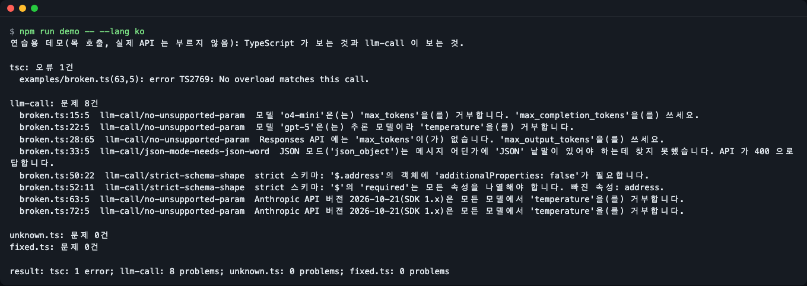
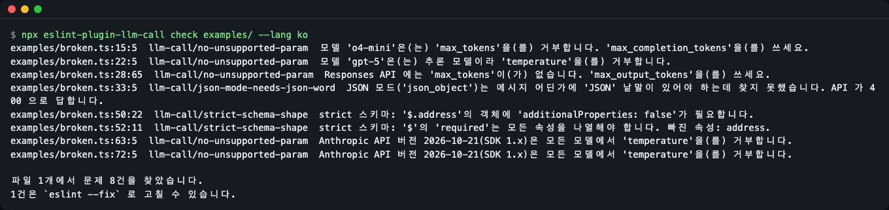
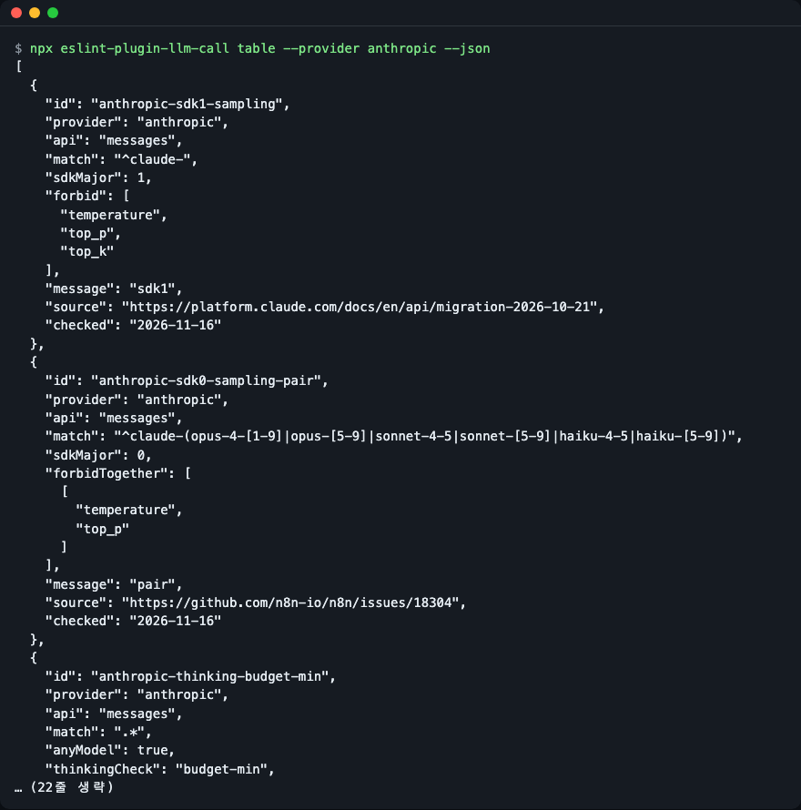
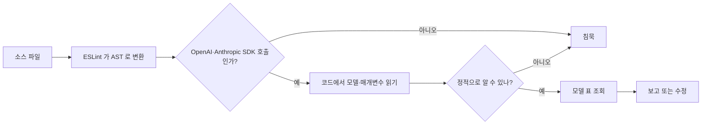

# eslint-plugin-llm-call

[English](README.md) | **한국어**

[](https://www.npmjs.com/package/eslint-plugin-llm-call) [](https://github.com/LeeGyeongPil/eslint-plugin-llm-call/actions/workflows/ci.yml) [](LICENSE)

OpenAI·Anthropic SDK 호출을 읽어서, TypeScript 는 통과시키지만 API 는 HTTP 400 으로 거절하는 매개변수 실수를 잡아 주는 ESLint 플러그인입니다. 추론 모델의 `max_tokens`, 거부되는 `temperature`, "JSON" 낱말 없는 JSON 모드, `additionalProperties: false` 가 빠진 strict 스키마 같은 것들입니다. 모델이 무엇인지 알 수 없으면 아무 말도 하지 않습니다.


*`npm run demo`: 같은 예제 파일을 실제 TypeScript 컴파일러(1건)와 이 플러그인(8건)이 본 결과입니다. 호출은 연습용 목(mock)이고 실제 API 는 부르지 않습니다.*

## 무엇을 더해 주나요

- `chat.completions.create`, `responses.create`, Anthropic `messages.create` 의 인자를 검사하는 **규칙 5개**.
- **출처가 붙은 모델 표.** [`src/data/models.json`](src/data/models.json) 의 행마다 출처 URL 과 확인 날짜가 있고, ESLint 설정에서 행을 추가·교체·끌 수 있습니다.
- **의미가 확실할 때만 자동 수정.** `max_tokens` 를 `max_completion_tokens` / `max_output_tokens` 로 바꾸는 것은 autofix, 매개변수 삭제나 값 삽입은 제안(suggestion)만 합니다.
- **모르면 침묵.** `process.env`, 함수 인자, import 값, 알 수 없는 전개에서 온 모델은 보고하지 않습니다.
- **영어·한국어 메시지**와 작은 CLI(`table`, `check`).

| 규칙 | 잡는 것 |
|---|---|
| `llm-call/no-unsupported-param` | 모델·API 가 거부하는 매개변수(아래 표), 모델 표 기반 |
| `llm-call/json-mode-needs-json-word` | 보이는 메시지에 "json" 이 없는 `response_format: { type: 'json_object' }` |
| `llm-call/strict-schema-shape` | strict 인라인 JSON Schema: `additionalProperties: false` 누락, `required` 가 모든 속성을 담지 않음, 루트 `anyOf`, 미지원 키워드, 10단계 초과 중첩, 5000개 초과 속성 |
| `llm-call/anthropic-require-max-tokens` | `max_tokens` 가 없는 Anthropic `messages.create` (제안만) |
| `llm-call/anthropic-thinking-config` | 값이 리터럴일 때 API 가 400 으로 거부하는 Anthropic `messages.create` 의 `thinking` 설정: `budget_tokens` 가 1024 미만, Claude 4.7 이상에 `type: 'enabled'`, Claude 4.5 이하에 `type: 'adaptive'`. `budget_tokens >= max_tokens` 는 interleaved thinking 이 허용하므로 보고하지 않습니다. 표의 `anthropic-thinking-*` 행이며 `settings.llmCall.disable` 로 끌 수 있습니다. 0.2.0 에서 추가, `recommended` 에서 `error` 로 켜집니다(마이너 버전 변경: 실제로 400 이 나는 코드는 이제 lint 에서 실패합니다). |

`no-unsupported-param` 이 지금 아는 것(2026-11-16 기준 스냅샷):

| 상황 | 보고하는 것 |
|---|---|
| chat completions 의 OpenAI `o1`..`o9`, `gpt-5*` | `max_tokens` (수정: `max_completion_tokens`) |
| OpenAI Responses API, 모든 모델 | `max_tokens` (수정: `max_output_tokens`) |
| OpenAI `o*`, `gpt-5` (`gpt-5-chat*` 제외) | `temperature`, `top_p` |
| OpenAI `gpt-5.1` 이후 | `reasoning_effort`(또는 `reasoning.effort`)가 `'none'` 이 아닌 리터럴로 적혀 있을 때만 `temperature`, `top_p`. 없거나 리터럴이 아니면 침묵 |
| Anthropic SDK 1.x (API 버전 2026-10-21) | `temperature`, `top_p`, `top_k` |
| Anthropic SDK 0.x, Opus 4.1+, Sonnet 4.5+, Haiku 4.5+ | `temperature` 와 `top_p` 동시 사용 |

## 요구 사항

| 호스트 | 확인한 버전 | 비고 |
|---|---|---|
| Node.js | 22.13 이상, 24 이상 (CI 는 22·24·26 을 돌립니다) | Node 20 은 지원 종료라 `engines` 는 `^22.13.0 \|\| >=24` 입니다 |
| ESLint | 10.15.0 (peer 범위 `^9.0.0 \|\| ^10.0.0`) | flat config 만 지원 |
| TypeScript 파일 | `@typescript-eslint/parser` 8.72.2 | `.ts` 검사에만 필요, `.js` 는 기본 파서로 됩니다 |
| `openai` / `@anthropic-ai/sdk` | 7.57.0 / 1.8.0 (데모용 개발 의존성) | 플러그인은 코드를 읽을 뿐 패키지를 쓰지 않습니다. 단 Anthropic SDK 메이저 버전을 알아낼 때만 읽습니다 |

런타임 의존성은 없습니다.

## 설치

```bash
npm install --save-dev eslint eslint-plugin-llm-call
```

`eslint.config.mjs` 에 추가합니다.

```js
import llmCall from 'eslint-plugin-llm-call';

export default [llmCall.configs.recommended];
```

TypeScript 는 파서도 함께 씁니다.

```js
import tsParser from '@typescript-eslint/parser';
import llmCall from 'eslint-plugin-llm-call';

export default [
  { files: ['**/*.ts'], languageOptions: { parser: tsParser } },
  llmCall.configs.recommended,
];
```

`recommended` 는 규칙 5개를 모두 `error` 로 켭니다. 규칙을 직접 고르려면 `plugins: { 'llm-call': llmCall }` 를 등록하고 원하는 규칙만 적습니다.

묶은 tarball 을 새 프로젝트(ESLint 10.15.0)에 설치해 확인했습니다(`npm run smoke:pack`): `o4-mini` 에 `max_tokens` 가 있는 파일은 `llm-call/no-unsupported-param` 과 함께 종료 코드 1, 깨끗한 파일은 0 입니다.

## 사용법

**편집기·CI 에서:** 평소처럼 `npx eslint .` 를 실행합니다. 문제는 밑줄로 보이고 `--fix` 는 안전한 이름 변경을 적용합니다.

```text
  7:3  error  Model 'o4-mini' rejects 'max_tokens'; use 'max_completion_tokens' instead  llm-call/no-unsupported-param
```

(뜻: 모델 `o4-mini` 는 `max_tokens` 를 거부하므로 `max_completion_tokens` 를 쓰라는 영어 메시지입니다. 메시지 언어는 아래 [언어](#언어) 절에서 바꿉니다.)

`npx eslint --fix` 후 호출은 이렇게 바뀝니다(호출 하나짜리 파일에서 실제로 나온 출력).

```diff
   model: 'o4-mini',
-  max_tokens: 200,
+  max_completion_tokens: 200,
   messages: [{ role: 'user', content: 'Say hi' }],
```

**ESLint 설정 없이:** 함께 들어 있는 CLI 가 권장 규칙으로 파일을 검사합니다.

```bash
npx eslint-plugin-llm-call check examples/ --lang ko
```

`examples/` 폴더는 이 저장소를 클론한 안([개발·기여](#개발기여))에만 있습니다. 내 프로젝트에서는 `src/` 처럼 자신의 폴더를 넘기세요. TypeScript 파일은 `@typescript-eslint/parser` 설치가 필요합니다.


*`check` 는 `파일:줄:열`, 규칙 ID, 메시지를 출력합니다. 종료 코드: 0 = 문제 없음, 1 = 문제 있음(해석하지 못한 파일 포함), 2 = 해당하는 파일이 없거나 그 밖의 사용 오류.*

제약 표(어떤 모델이 어떤 매개변수를 거부하는지, 행의 출처, 확인 날짜)를 보려면:

```bash
npx eslint-plugin-llm-call table --provider anthropic --lang ko
```

`--provider openai|anthropic` 은 행을 거르고 `--json` 은 JSON 으로 출력합니다. 좁은 화면에는 JSON 이 잘 맞습니다.

```bash
npx eslint-plugin-llm-call table --provider anthropic --json
```


*표는 스냅샷입니다. 모든 행에 출처와 날짜가 표시됩니다. (JSON 은 언어와 무관해 두 README 가 같은 이미지를 씁니다.)*

### 언어

메시지와 CLI 출력은 영어 또는 한국어입니다. 고르는 순서: `--lang en|ko`, `LLM_CALL_LINT_LANG`, `LC_ALL`, `LC_MESSAGES`, `LANG`(`ko` 로 시작하면 한국어, 아니면 영어). ESLint 규칙 메시지는 플러그인이 로드될 때 정해지므로, 편집기 밑줄을 한국어로 보려면 `LLM_CALL_LINT_LANG=ko` 를 설정한 채 편집기나 ESLint 를 시작하세요.

### 침묵하는 경우

`examples/unknown.ts` 는 플러그인이 판단하면 안 되는 호출 모음이고, `npm run demo` 는 여기서 0건임을 보여 줍니다.

- 모델이 `process.env` 나 함수 인자에서 오는 경우
- `model` 을 덮어쓸 수 있는 `...overrides` 같은 알 수 없는 전개
- 표에 없는 모델 이름
- `AzureOpenAI` (배포 이름은 모델 ID 가 아님)
- OpenAI·Anthropic SDK 가 아닌 클라이언트(예: SMS 클라이언트)의 `client.messages.create`

플러그인이 따라가는 것은 문자열 리터럴, 표현식 없는 템플릿 리터럴, 같은 파일의 `const` 값, `as const` / `satisfies`, 같은 파일 `const` 객체의 전개뿐입니다. 이는 호출 옵션 객체 안의 값(예: `model`)에 적용됩니다. 옵션 객체 자체는 호출 위치에 직접 써야 합니다(알려진 한계 참고).

## 설정

flat config 의 `settings.llmCall` 아래에 둡니다.

```js
export default [
  llmCall.configs.recommended,
  {
    settings: {
      llmCall: {
        anthropicSdkMajor: 1,
        disable: ['openai-gpt5x-sampling'],
        models: [
          {
            id: 'my-model-no-top-p',
            provider: 'openai',
            api: 'any',
            match: '^my-reasoner-',
            forbid: ['top_p'],
            message: 'reasoning',
            source: 'https://example.com/notes',
            checked: '2026-11-16',
          },
        ],
      },
    },
  },
];
```

| 키 | 기본값 | 설명 |
|---|---|---|
| `llmCall.models` | `[]` | 추가 행. 기존 `id` 와 같으면 내장 행을 교체합니다. 필드: `id`, `provider`, `api`, `match`(정규식), `exclude`, `forbid`, `forbidTogether`, `replace`, `allowWhen`, `message`, `source`, `checked`, `sdkMajor` |
| `llmCall.disable` | `[]` | 끌 행 id (`table` 출력에 있습니다) |
| `llmCall.anthropicSdkMajor` | 자동 | `0` 또는 `1`. 기본은 검사 파일 위치에서 위로 올라가며 `node_modules/@anthropic-ai/sdk/package.json` 을 찾고, 못 찾으면 Anthropic 샘플링 행은 침묵합니다 |
| `json-mode-needs-json-word` 옵션 `countInstructions` | `true` | `false` 면 `instructions` 는 무시하고 메시지만 셉니다 |

## 동작 원리



1. ESLint 가 파일을 구문 트리로 바꿉니다. 타입·네트워크·API 키는 쓰지 않습니다.
2. 같은 파일에서 `openai` 나 `@anthropic-ai/sdk` import 로 만든 클라이언트의 호출만 대상입니다.
3. 모델과 매개변수는 값이 리터럴이거나 같은 파일 상수일 때만 읽고, 나머지는 알 수 없음(Unknown)입니다.
4. 값을 모르면 보고하지 않습니다. 틀린 밑줄은 놓친 밑줄보다 신뢰를 더 깎습니다.
5. 아는 값은 표와 맞춰 보고, 걸리면 ESLint 보고가 됩니다. 대체가 모호하지 않을 때만 자동 수정을 붙입니다.

플러그인은 네트워크로 아무것도 보내지 않습니다. ESLint 가 넘겨 준 소스 파일과, Anthropic SDK 버전을 알아낼 때 `node_modules` 아래 `package.json` 하나만 읽습니다.

## 언제 쓰나

- 이럴 때: OpenAI·Anthropic JS/TS SDK 를 직접 부르고, 가끔 모델을 바꾸며, 실수를 400 응답이 아니라 편집기·CI 에서 찾고 싶을 때.
- 다루지 않는 것: Python 코드, 다른 SDK(Vercel AI SDK, Google), 다른 파일·래퍼 함수에서 오는 값, LLM 앱 일반 ESLint 규칙(토큰 한도·보안). 이런 경우는 다른 ESLint 플러그인이나 코드 안 런타임 검사를 보세요. 이 플러그인은 그것들을 대체하려 하지 않습니다.

## 다른 도구와 비교

이 플러그인이 보는 것은 하나, "이 모델이 이 매개변수를 받아 주는가"입니다. 다른 도구는 다른 곳을 보므로 함께 쓸 수 있습니다. 이름과 링크만 적었으니 지금 하는 일은 각 프로젝트에서 확인하세요(링크 확인 2026-11-16).

- [eslint-plugin-llm-app](https://www.npmjs.com/package/eslint-plugin-llm-app): 한도·타임아웃·재시도 같은 LLM 앱 일반 규칙. 특정 모델에 묶여 있지 않습니다.
- [eslint-plugin-openai-security](https://www.npmjs.com/package/eslint-plugin-openai-security), [eslint-plugin-anthropic-security](https://www.npmjs.com/package/eslint-plugin-anthropic-security): 보안 중심 규칙. 브라우저 키 검사는 이쪽에 맡기고 이 플러그인은 넣지 않았습니다.
- [eslint-plugin-vercel-ai-security](https://www.npmjs.com/package/eslint-plugin-vercel-ai-security): Vercel AI SDK 용입니다. 이 플러그인은 그 SDK 를 읽지 않습니다.
- TypeScript 타입: 인자의 모양을 검사할 뿐 특정 모델이 받아 주는지는 보지 않습니다(위 데모에서 `tsc` 1건, 이 플러그인 8건).
- [LiteLLM `drop_params`](https://docs.litellm.ai/docs/completion/drop_params): 요청 시점에 지원하지 않는 매개변수를 버리는 Python 런타임 옵션. 이 플러그인은 배포 전에 JS/TS 소스를 보고, 동작을 조용히 바꾸지 않습니다.

## 알려진 한계

- 표는 2026-11-16 날짜의 스냅샷입니다. 제공사 규칙은 바뀝니다. 행의 출처 URL 을 확인하고, 틀린 행은 `settings.llmCall` 로 고치세요.
- 행의 근거는 연결된 페이지이고 API 를 직접 불러 확인한 것이 아닙니다. 출처 중에는 제공사 가이드도, 이슈 글이나 지식 베이스 글도 있습니다. `gpt-5.1` 이후는 기본 reasoning effort 를 추측하지 않습니다. 호출에 `reasoning_effort` 가 없으면 침묵하고, effort 가 `'none'` 이 아닌 리터럴일 때만 `temperature` / `top_p` 를 보고합니다. 행이 경험과 다르면 `disable` 하세요(예: `openai-gpt5x-sampling`).
- 자동 수정은 키가 일반 이름이나 문자열로 적혀 있을 때만 이름을 바꿉니다. `[k]: 5` 같은 계산된 키는 보고만 하고 고치지 않습니다. 고치면 존재하지 않는 이름을 가리킬 수 있기 때문입니다.
- strict 스키마 중첩 한도는 루트 객체를 0단계로 세고 그 아래 10단계를 넘으면 보고합니다. 문서가 루트 포함 여부를 분명히 밝히지 않아 덜 공격적인 해석을 택했습니다.
- 같은 파일 상수만 따라갑니다. 다른 파일에 정의된 모델은 Unknown 입니다.
- 호출 인자는 인라인 객체 리터럴이어야 합니다. `{ ... } as const`, `{ ... } satisfies T` 로 쓰거나 변수로 넘기면(`const p = { ... }; client.create(p)`) 규칙은 침묵합니다. `as const`·`satisfies`·`const` 는 인라인 객체 안의 값에만 따라갑니다.
- 같은 SDK 클라이언트임을 알 수 없는 값으로 다시 할당된 클라이언트 변수는 Unknown 이 되어 그 호출은 침묵합니다. 같은 SDK 의 다른 클라이언트로 다시 할당하면 계속 검사합니다.
- 현재 폴더 밖 파일은 `check` 가 건너뛰고 안내만 낸 뒤 종료 코드 0 으로 끝납니다. 그 파일이 들어 있는 상위 폴더에서 실행하세요. TypeScript 파일 `check` 는 `@typescript-eslint/parser` 설치가 필요합니다.
- `check` 는 `llm-call` 규칙만 돌립니다. 다른 규칙용 주석(`// eslint-disable-next-line no-console`, `/* eslint react/no-danger: 2 */`)은 무시하고 문제로 세지 않습니다. `// eslint-disable-next-line llm-call/...` 는 그대로 지킵니다.
- 검사 대상이 아닌 파일(`node_modules/`·`dist/` 아래, JavaScript 가 아닌 파일)은 stderr 에 짧은 안내만 내고 문제로 세지 않습니다.
- `--lang ko` 여도 두 가지는 영어로 남습니다: 구문 오류의 파서 원문(예: `Unexpected token ;`)과 잘못된 인라인 규칙 옵션에 대한 ESLint 메시지.

## 자주 겪는 문제

| 증상 | 원인 | 해결 |
|---|---|---|
| 실패해야 할 호출인데 보고가 없음 | 모델·인자·전개를 정적으로 알 수 없거나, 클라이언트가 그 파일의 `openai` / `@anthropic-ai/sdk` import 에서 오지 않음 | 리터럴 모델이나 같은 파일 `const` 를 쓰고, `table` 로 어떤 행이 있는지 확인 |
| Anthropic `temperature` 가 전혀 보고되지 않음 | `node_modules` 에서 SDK 버전을 찾지 못함 | `@anthropic-ai/sdk` 를 설치하거나 `settings.llmCall.anthropicSdkMajor` 지정 |
| `check` 가 `.ts` 파일을 건너뜀 | 프로젝트에 `@typescript-eslint/parser` 가 없음 | `npm install --save-dev @typescript-eslint/parser`, 또는 자체 설정으로 ESLint 사용 |
| 편집기에서 메시지가 영어로만 나옴 | 언어는 플러그인이 로드될 때 읽음 | `LLM_CALL_LINT_LANG=ko` 를 설정하고 편집기나 ESLint 를 시작 |
| `check` 가 `'...' 에 해당하는 파일이 없습니다` 를 내고 종료 코드 2 | 경로가 없거나, 폴더가 비었거나, glob 이 아무것도 못 찾음 | 경로를 확인하거나 프로젝트 폴더에서 실행 |
| `check` 가 `parse-error` 를 보고 | 파일에 구문 오류가 있거나, TypeScript 를 기본 파서로 읽음 | 파서 원문이 가리키는 구문을 고치고, `.ts` 면 `@typescript-eslint/parser` 설치 |
| 내 모델에 행이 틀려 보임 | 표는 날짜가 붙은 스냅샷 | `settings.llmCall.models` 에 같은 `id` 의 행을 추가하거나 `disable` 에 id 추가 |

## 개발·기여

```bash
git clone https://github.com/LeeGyeongPil/eslint-plugin-llm-call.git
cd eslint-plugin-llm-call
npm install
npm test          # 테스트 실행 (Node 22.13 이상 필요)
npm run demo      # 연습용 데모. 언어는 --lang, LLM_CALL_LINT_LANG, LANG 순 (-- --lang en|ko 로 지정)
npm run verify    # 빌드 + 테스트 + 데모를 한 번에
CI_REPRO_COMMITTED=1 npm run ci:repro  # 커밋된 파일만으로 CI 단계를 다시 실행(커밋하지 않은 변경은 무시)
npm run ci:repro  # git 이 추적하는 파일(작업 폴더 내용, 새 파일은 먼저 `git add`)만 깨끗한 폴더에 복사해 CI 단계를 다시 실행
npm run smoke:pack
```

모델 행 추가: `src/data/models.json` 의 모든 행에는 `source`(https URL)와 `checked` 날짜(YYYY-MM-DD)가 필요하고, `test/data.test.ts` 가 둘 다 검사합니다.

변경 기록은 [CHANGELOG.md](CHANGELOG.md).

## 라이선스

MIT.
