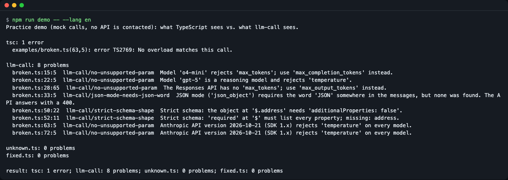
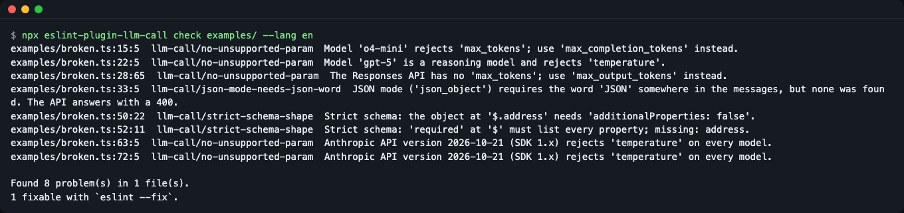
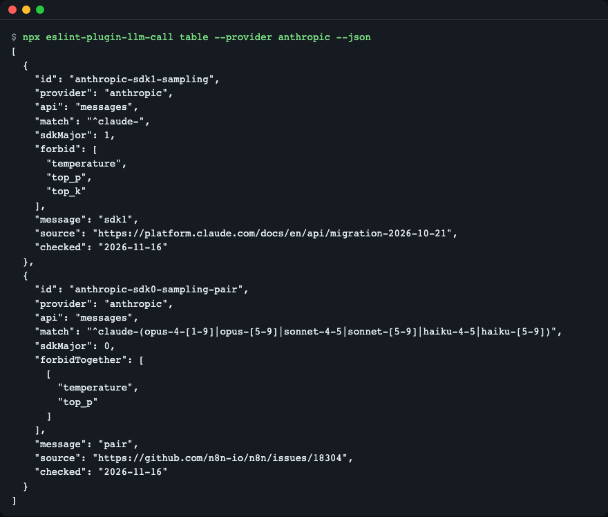
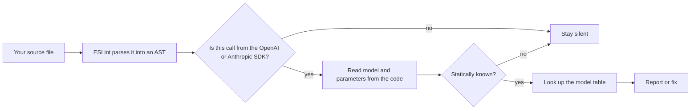

# eslint-plugin-llm-call

**English** | [한국어](README.ko.md)

An ESLint plugin that reads your OpenAI and Anthropic SDK calls and flags parameter mistakes that TypeScript accepts but the API answers with HTTP 400: `max_tokens` on a reasoning model, `temperature` where it is rejected, JSON mode without the word "JSON", strict schemas missing `additionalProperties: false`. When it cannot tell what the model is, it stays silent.


*`npm run demo`: the same fixture file seen by the real TypeScript compiler (1 error) and by this plugin (8 problems). The calls are practice mocks; no API is contacted.*

## What it adds

- **Four rules** that check the arguments of `chat.completions.create`, `responses.create` and Anthropic `messages.create`.
- **A model table with sources.** Each row of [`src/data/models.json`](src/data/models.json) carries a source URL and a check date, and you can add, replace or switch off rows from your ESLint settings.
- **Quick fixes only when the meaning is certain.** Renaming `max_tokens` to `max_completion_tokens` / `max_output_tokens` is an autofix; deleting a parameter or inserting a value is only a suggestion.
- **Silence when unsure.** A model that comes from `process.env`, a function argument, an import or an unknown spread is never reported.
- **English and Korean messages**, and a small CLI (`table`, `check`).

| Rule | Catches |
|---|---|
| `llm-call/no-unsupported-param` | Parameters the model or API rejects (see the table below), driven by the model table |
| `llm-call/json-mode-needs-json-word` | `response_format: { type: 'json_object' }` with no "json" in the visible messages |
| `llm-call/strict-schema-shape` | Strict inline JSON Schemas: missing `additionalProperties: false`, `required` not listing every property, root `anyOf`, unsupported keywords, nesting deeper than 10, more than 5000 properties |
| `llm-call/anthropic-require-max-tokens` | Anthropic `messages.create` without `max_tokens` (suggestion only) |

What `no-unsupported-param` knows today (snapshot dated 2026-11-16):

| Situation | Reported |
|---|---|
| OpenAI `o1`..`o9`, `gpt-5*` on chat completions | `max_tokens` (fix: `max_completion_tokens`) |
| OpenAI Responses API, any model | `max_tokens` (fix: `max_output_tokens`) |
| OpenAI `o*` and `gpt-5` (not `gpt-5-chat*`) | `temperature`, `top_p` |
| OpenAI `gpt-5.1` and later | `temperature`, `top_p` only when `reasoning_effort` (or `reasoning.effort`) is written as a literal other than `'none'`; silent when it is absent or not a literal |
| Anthropic SDK 1.x (API version 2026-10-21) | `temperature`, `top_p`, `top_k` |
| Anthropic SDK 0.x, Opus 4.1 and later | `temperature` and `top_p` together |

## Requirements

| Host | Version checked | Notes |
|---|---|---|
| Node.js | 22.13+ and 24+ (CI runs 22, 24 and 26) | Node 20 is end-of-life; `engines` is `^22.13.0 || >=24` |
| ESLint | 10.15.0 (peer range `^9.0.0 \|\| ^10.0.0`) | Flat config only |
| TypeScript files | `@typescript-eslint/parser` 8.72.2 | Needed only to lint `.ts`; plain `.js` works with the default parser |
| `openai` / `@anthropic-ai/sdk` | 7.57.0 / 1.8.0 (dev dependencies, used by the demo) | Your project needs them only to import; the plugin reads the code, not the packages, except to detect the Anthropic SDK major version |

The plugin has no runtime dependencies.

## Install

```bash
npm install --save-dev eslint eslint-plugin-llm-call
```

Add it to `eslint.config.mjs`:

```js
import llmCall from 'eslint-plugin-llm-call';

export default [llmCall.configs.recommended];
```

For TypeScript, add the parser too:

```js
import tsParser from '@typescript-eslint/parser';
import llmCall from 'eslint-plugin-llm-call';

export default [
  { files: ['**/*.ts'], languageOptions: { parser: tsParser } },
  llmCall.configs.recommended,
];
```

`recommended` turns all four rules on as `error`. To pick rules yourself, register `plugins: { 'llm-call': llmCall }` and list the rules you want.

The packed tarball was verified in a fresh project with ESLint 10.15.0 (`npm run smoke:pack`): a file with `max_tokens` on `o4-mini` exits 1 with `llm-call/no-unsupported-param`, a clean file exits 0.

## Usage

**In the editor or CI:** run `npx eslint .` as usual. Problems appear as underlines, and `--fix` applies the safe renames.

```text
  7:3  error  Model 'o4-mini' rejects 'max_tokens'; use 'max_completion_tokens' instead  llm-call/no-unsupported-param
```

After `npx eslint --fix`, the call is changed like this (real output of the command on a one-call file):

```diff
   model: 'o4-mini',
-  max_tokens: 200,
+  max_completion_tokens: 200,
   messages: [{ role: 'user', content: 'Say hi' }],
```

**Without an ESLint config:** the bundled CLI lints files with the recommended rules.

```bash
npx eslint-plugin-llm-call check examples/ --lang en
```


*`check` prints `file:line:column`, the rule id and the message, and exits 1 when anything is found.*

To read the constraint table (which models reject which parameters, where the row comes from, when it was checked):

```bash
npx eslint-plugin-llm-call table --provider anthropic --lang en
```

`--provider openai|anthropic` filters rows and `--json` prints them as JSON, which fits a narrow screen:

```bash
npx eslint-plugin-llm-call table --provider anthropic --json
```


*The table is a snapshot; every row shows its source and date.*

### Language

Messages and CLI output are English or Korean. Order of choice: `--lang en|ko`, then `LLM_CALL_LINT_LANG`, then `LC_ALL`, `LC_MESSAGES`, `LANG` (Korean if it starts with `ko`, otherwise English). ESLint rule messages are fixed when the plugin loads, so for editor underlines start the editor or ESLint with `LLM_CALL_LINT_LANG=ko` set.

### What stays silent

`examples/unknown.ts` holds calls the plugin must not judge; `npm run demo` shows it reports 0 problems there:

- model from `process.env` or a function argument;
- an unknown spread such as `...overrides`, which could overwrite `model`;
- a model name that is not in the table;
- `AzureOpenAI` (a deployment name is not a model id);
- `client.messages.create` where `client` is not from the OpenAI or Anthropic SDK (for example an SMS client).

The plugin only follows string literals, template literals without expressions, same-file `const` values, `as const` / `satisfies`, and spreads of same-file `const` objects.

## Settings

Put these under `settings.llmCall` in your flat config:

```js
export default [
  llmCall.configs.recommended,
  {
    settings: {
      llmCall: {
        anthropicSdkMajor: 1,
        disable: ['openai-gpt5x-sampling'],
        models: [
          {
            id: 'my-model-no-top-p',
            provider: 'openai',
            api: 'any',
            match: '^my-reasoner-',
            forbid: ['top_p'],
            message: 'reasoning',
            source: 'https://example.com/notes',
            checked: '2026-11-16',
          },
        ],
      },
    },
  },
];
```

| Key | Default | Description |
|---|---|---|
| `llmCall.models` | `[]` | Extra rows. A row with an existing `id` replaces the built-in row. Fields: `id`, `provider`, `api`, `match` (regex), `exclude`, `forbid`, `forbidTogether`, `replace`, `allowWhen`, `message`, `source`, `checked`, `sdkMajor` |
| `llmCall.disable` | `[]` | Row ids to switch off (ids are in the `table` output) |
| `llmCall.anthropicSdkMajor` | auto | `0` or `1`. By default the plugin looks for `node_modules/@anthropic-ai/sdk/package.json` upward from the linted file; if it cannot find it, the Anthropic sampling rows stay silent |
| `json-mode-needs-json-word` option `countInstructions` | `true` | Set `false` to ignore `instructions` and count only messages |

## How it works



1. ESLint turns the file into a syntax tree. No types, no network and no API key are used.
2. A call counts only if its client was created from an `openai` or `@anthropic-ai/sdk` import in the same file.
3. The model and parameters are read only when their value is a literal or a same-file constant; anything else is Unknown.
4. If the value is Unknown, the rule does not report. A wrong underline costs more trust than a missed one.
5. Known values are matched against the table; a hit becomes an ESLint report, with a fix only when the replacement is unambiguous.

The plugin never sends anything over the network. It reads only the source files ESLint gives it and, for the Anthropic SDK version, one `package.json` under `node_modules`.

## When to use it

- Good fit: you call the OpenAI or Anthropic JS/TS SDK directly, switch models now and then, and want mistakes found in the editor or CI instead of in a 400 response.
- Not covered: Python code, other SDKs (Vercel AI SDK, Google), values coming from other files or wrapper functions, and general ESLint rules for LLM apps (token limits, security). For those, look at other ESLint plugins or a runtime check in your own code; this plugin does not try to replace them.

## Compared with other tools

This plugin looks at one thing: whether this model accepts this parameter. Other tools look elsewhere, so they can sit next to it. Names and links only; check each project for what it does today (links checked 2026-11-16).

- [eslint-plugin-llm-app](https://www.npmjs.com/package/eslint-plugin-llm-app): general rules for LLM apps (limits, timeouts, retries), not tied to a specific model.
- [eslint-plugin-openai-security](https://www.npmjs.com/package/eslint-plugin-openai-security) and [eslint-plugin-anthropic-security](https://www.npmjs.com/package/eslint-plugin-anthropic-security): security-focused rules. This plugin leaves browser-key checks to them.
- [eslint-plugin-vercel-ai-security](https://www.npmjs.com/package/eslint-plugin-vercel-ai-security): for the Vercel AI SDK, which this plugin does not read.
- TypeScript types: they check the shape of the arguments, not whether a given model accepts them (the demo above shows 1 error from `tsc` against 8 from this plugin).
- [LiteLLM `drop_params`](https://docs.litellm.ai/docs/completion/drop_params): a Python runtime option that drops unsupported parameters at request time. This plugin works on JS/TS source before deploy and does not change behavior silently.

## Known limits

- The table is a snapshot dated 2026-11-16. Providers change rules; check the source URL of a row before trusting it and fix rows through `settings.llmCall`.
- The rows are justified by the linked pages, not by calling the APIs. Some sources are provider guides and some are issue threads or knowledge-base articles. For `gpt-5.1` and later, the plugin does not guess the default reasoning effort: with no `reasoning_effort` in the call it stays silent, and it reports `temperature` / `top_p` only when the effort is a literal other than `'none'`. If a row does not match your experience, `disable` it (for example `openai-gpt5x-sampling`).
- The autofix renames a key only when it is written as a plain name or string. A computed key such as `[k]: 5` is reported without a fix, because rewriting it could point at a name that does not exist.
- The nesting limit for strict schemas counts the root object as level 0 and reports more than 10 nested levels below it; the documentation does not say clearly whether the root counts, so the less eager reading is used.
- Only same-file constants are followed. A model defined in another file is Unknown.
- A client variable that is reassigned later is still treated as its first value, so the rules may report (or autofix) a call made through the new client.
- `check` run on a file outside the current folder may print `undefined:undefined parse-error`; run it from the project folder. `check` on TypeScript files needs `@typescript-eslint/parser` installed.

## Troubleshooting

| Symptom | Cause | Fix |
|---|---|---|
| No report on a call that should fail | The model, an argument or a spread is not statically known, or the client does not come from an `openai` / `@anthropic-ai/sdk` import in that file | Use a literal model or a same-file `const`; run `table` to see which rows exist |
| Anthropic `temperature` is never reported | The SDK version was not found in `node_modules` | Install `@anthropic-ai/sdk`, or set `settings.llmCall.anthropicSdkMajor` |
| `check` skips `.ts` files | The project has no `@typescript-eslint/parser` | `npm install --save-dev @typescript-eslint/parser`, or use ESLint with your own config |
| Messages stay English in the editor | The language is read when the plugin loads | Start the editor or ESLint with `LLM_CALL_LINT_LANG=ko` |
| A row looks wrong for your model | The table is a dated snapshot | Add a row with the same `id` in `settings.llmCall.models`, or add its id to `disable` |

## Development

```bash
git clone https://github.com/LeeGyeongPil/eslint-plugin-llm-call.git
cd eslint-plugin-llm-call
npm install
npm test          # 147 tests (needs Node 22.12 or newer)
npm run demo      # practice demo; language follows --lang, LLM_CALL_LINT_LANG, LANG (add -- --lang en|ko)
npm run smoke:pack
```

Adding a model row: every row in `src/data/models.json` needs a `source` (https URL) and a `checked` date (YYYY-MM-DD); `test/data.test.ts` enforces both.

See [CHANGELOG.md](CHANGELOG.md) for changes.

## License

MIT.
